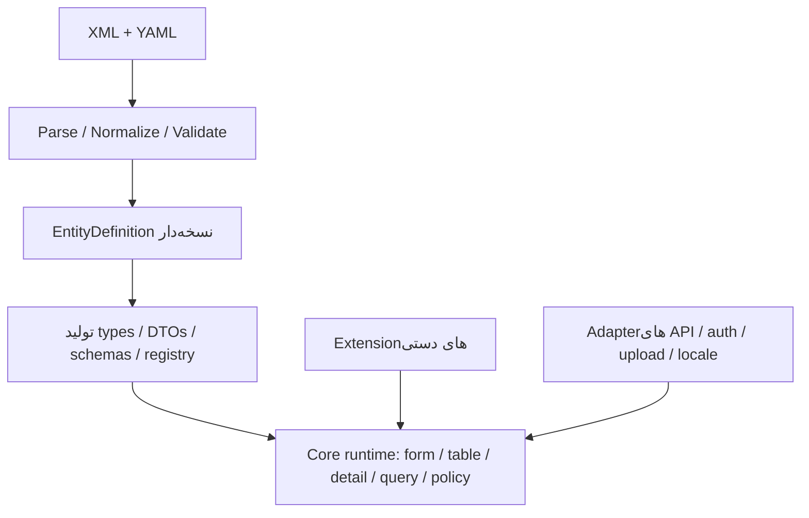

# بررسی آمادگی core برای جنریتور فرانت‌اند

> این گزارش وضعیت پیش از اصلاحات را ثبت می‌کند. موارد اجرایی آن در این تغییر پیاده‌سازی شده‌اند؛ برای وضعیت فعلی، [پلن اجرا](IMPLEMENTATION_PLAN.md) و [راهنمای core](CORE_GUIDE.fa.md) را ببینید. شواهد و شماره‌خط‌های زیر مربوط به نسخهٔ بررسی‌شدهٔ اولیه هستند.

تاریخ بررسی: ۲۰۲۶/۱۱/۱۶

هدف این بررسی، ارزیابی زیرساخت یک جنریتور قابل اتکای فرانت‌اند است. دامنه شامل `src/core`، راه‌اندازی برنامه، احراز هویت و مسیریابی، جنریتور XML/YAML و نمونه‌های خروجی، به‌خصوص `ComprehensiveEntity` است. در این بررسی کد اجرایی برنامه تغییر نکرده است.

## نتیجه

پروژه پایه‌های کاربردی یک سیستم CRUD مبتنی بر متادیتا را دارد: سرویس پایه، فرم‌های React Hook Form و Zod، جدول سروری، ورودی رابطه و فایل، نمایش رکورد، مسیرهای ماژولی و قالب‌های جنریتور. کمبود اصلی، قرارداد مشترکی است که تعریف موجودیت، مدل پاسخ API، دادهٔ فرم، اعتبارسنجی، فیلتر، جدول و مجوزها را هماهنگ کند.

در وضعیت فعلی، اضافه‌کردن یک نوع فیلد یا یک موجودیت جدید می‌تواند به اصلاح دستی چند قالب، فایل متادیتا، فرم، مسیر و مجوز نیاز پیدا کند. پیش از گسترش تعداد قابلیت‌ها، باید همین زنجیره به‌شکل قابل آزمون کامل شود.

## شواهد اجرایی

| بررسی                                                    | نتیجه                                                                                                                            |
| -------------------------------------------------------- | -------------------------------------------------------------------------------------------------------------------------------- |
| TypeScript برنامه با `tsc -p tsconfig.app.json --noEmit` | ناموفق؛ ارسال `DraftDto` به پارامتر boolean در `PlatformAuthorizationControllerService.ts:23`                                    |
| `npm run build`                                          | ناموفق در مرحلهٔ `tsc -b` با همان خطا؛ مرحلهٔ Vite اجرا نشد                                                                      |
| ESLint با تنظیمات فعلی مخزن                              | ۳۱۹ خطا و ۱۰ هشدار؛ ۱۲۸ فایل دارای پیام؛ از خطاها، ۱۳ مورد مربوط به قواعد Hooks است                                              |
| schema واقعی `ComprehensiveEntityCreate`                 | رشتهٔ `$` برخلاف `minLength/pattern`، عدد `1001` برخلاف حداکثر `1000`، enum نامعتبر و رشته به‌جای رابطهٔ اجباری را قبول می‌کند   |
| تبدیل دادهٔ عددی در همان schema                          | مقدار `"42"` بعد از اعتبارسنجی همچنان string است                                                                                 |
| `BaseService` با API شبیه‌سازی‌شده مطابق envelope فعلی   | `getById` رکورد را برمی‌گرداند؛ `create/update` envelope را، درحالی‌که نوع خروجی هر سه `T` اعلام شده است                         |
| فرم تولیدشدهٔ نمونه                                      | ورودی `bigDecimalField` وجود ندارد؛ سه فیلد چندتایی `oneToManyKeywords`، `manyToManyMessages` و `attachments` بدون `multi` هستند |
| TypeScript جنریتور                                       | در محیط فعلی قابل تأیید نیست؛ `generator/node_modules` نصب نشده و dependency/typeهای لازم در دسترس نیستند                        |

آزمون‌های schema با استخراج تعریف واقعی schema از فایل موجود و اجرای Validator فعلی انجام شدند. آزمون سرویس از mock استفاده کرد و به سرور وصل نشد. اجرای کامل جنریتور و آزمون مرورگر انجام نشد. شمار خطاهای lint به‌معنای وجود ۳۱۹ اشکال رفتاری مستقل نیست؛ بیشتر پیام‌ها مربوط به متغیرهای استفاده‌نشده و `any` هستند.

## خطاها و ناهماهنگی‌های فعلی

### ۱. اتصال محافظ دسترسی ناقص است — اولویت فوری

- در [router/index.tsx](../src/router/index.tsx)، شاخهٔ dashboard در خط ۴۱ از `PublicRoute` استفاده می‌کند؛ `ProtectedRoute` فقط import شده است.
- در [ProtectedRoute.tsx](../src/core/router/ProtectedRoute.tsx)، خط ۲۲ مسیر با برابری رشته‌ای تطبیق داده می‌شود؛ مسیری مثل `/items/:id/edit` با `/items/42/edit` تطبیق نمی‌یابد.
- کنترل مجوز در `TableLink` موجود است، اما دکمهٔ ایجاد در `Page.hbs`، دکمهٔ ویرایش در `Display.hbs` و حذف گروهی جدول به سیاست مشترک عملیات وصل نیستند.
- در `AuthContext.logout` کش React Query پاک نمی‌شود؛ کلیدهای query نیز به کاربر وابسته نیستند. بنابراین دادهٔ حساب قبلی می‌تواند در کش حساب بعدی باقی بماند.

اقدام لازم: یک مسیر مشترک برای تطبیق route و اجرای سیاست دسترسی، همراه با پاک‌کردن یا تفکیک کش هنگام تعویض حساب. این یافته‌ها مربوط به حفاظت و نمایش فرانت‌اند هستند؛ مجوز سمت سرور در این بررسی ارزیابی نشده است.

### ۲. قرارداد HTTP و سرویس پایه یکدست نیست — اولویت فوری

در [BaseService.ts](../src/core/service/BaseService.ts)، `getById` پاسخ را باز می‌کند، ولی `create/update` در خطوط ۱۱۳ و ۱۱۷ مستقیماً `api.post/put` را برمی‌گردانند. در [Axios.ts](../src/core/service/Axios.ts)، interceptor قبلاً `AxiosResponse` را به envelope تبدیل کرده است. نوع‌های Axios این تغییر را منعکس نمی‌کنند و castها مشکل را پنهان می‌کنند.

همچنین امضای positional متد `call(method, relativeUrl, pageType, data, params)` باعث خطای build فعلی شده است. `getAll` نیز وجود `meta` را اجباری فرض می‌کند و به یک شکل خاص صفحه‌بندی متصل است.

اقدام لازم: client تایپ‌شده برای بازکردن یک‌بارهٔ پاسخ، adapter صفحه‌بندی و متد درخواست با آرگومان شیئی مانند `{ method, path, body, query, signal }`. خروجی سرویس‌ها باید قرارداد مشخص `Entity`، `Page<Entity>` یا `void` داشته باشد.

### ۳. اعتبارسنجی تولیدشده محدودیت‌های موجودیت را اجرا نمی‌کند — اولویت فوری

در [Create.hbs](../generator/src/templates/Create.hbs)، خطوط ۴۳ تا ۵۸ برای فیلدهای اجباری فقط `Validator.notNull()` و برای سایر فیلدها `Validator.optional()` تولید می‌کنند. دومی `z.any().optional()` است. محدودیت‌های XML شامل نوع، `min/max`، `minLength/maxLength`، `pattern` و اعضای enum به schema منتقل نمی‌شوند. `maxLength` بعضی ورودی‌ها در UI اعمال می‌شود، اما schema آن را بررسی نمی‌کند.

[validationSchemaBuilder.ts](../src/core/forms/validationSchemaBuilder.ts) هم راه‌حل عمومی فعلی نیست: فیلدهای اختیاری را حذف می‌کند و تمام فیلدهای اجباری به‌جز boolean را string فرض می‌کند.

اقدام لازم: ساخت schema از قرارداد نرمال‌شدهٔ فیلد، همراه با قواعد جداگانهٔ فرم ایجاد و ویرایش، اعتبارسنجی ساختار رابطه و تبدیل صریح داده پیش از ارسال. یکتایی همچنان باید در سرور تضمین شود؛ core باید خطای آن را به فیلد مربوط متصل کند.

### ۴. دادهٔ فرم، DTO و مدل پاسخ از هم تفکیک نشده‌اند — اولویت فوری

- مدل جنریتور برای اعداد `number` تولید می‌کند، اما `FormInput` مقدار string ثبت می‌کند و schema فعلی آن را تبدیل نمی‌کند.
- `Partial<T>` برای ایجاد و ویرایش، تفاوت فیلدهای فقط‌خواندنی، فقط‌نوشتنی، اجباری در ایجاد و اختیاری در ویرایش را بیان نمی‌کند.
- `BaseModel.id` و متدهای سرویس عددی هستند؛ جدول و قالب‌ها نیز شناسه را با `Number()` تبدیل می‌کنند. شناسهٔ UUID یا string با این قرارداد پشتیبانی نمی‌شود.
- `LONG` و `BIG_DECIMAL` در helper و config به `number` تبدیل می‌شوند؛ برای مقادیر بزرگ یا اعشار دقیق باید سیاست حفظ دقت تعیین شود.

اقدام لازم: تعریف مستقل `Response`، `CreateInput`، `UpdateInput` و `FormValues`، به‌همراه `fromApi/toApi`، نوع شناسهٔ قابل تنظیم و تمایز `null`، مقدار خالی و فیلد ارسال‌نشده.

### ۵. پوشش نوع فیلد و روابط در قالب‌ها کامل نیست — اولویت فوری

شواهد اصلی در [ComprehensiveEntityCreate.tsx](../src/Models/ComprehensiveEntity/ComprehensiveEntityCreate.tsx) و [Create.hbs](../generator/src/templates/Create.hbs):

- نوع متادیتای `bigDecimalField` شاخهٔ رندر ندارد؛ ورودی آن حذف می‌شود.
- `LONG` و `DOUBLE` هم با `type="number"` ساخته می‌شوند. پیاده‌سازی فعلی `FormInput` این حالت را عدد صحیح و حداکثر ۱۱ کاراکتر در نظر می‌گیرد؛ ورودی اعشاری DOUBLE در این مسیر پذیرفته نمی‌شود.
- رابطهٔ to-many بدون `multi` ساخته می‌شود؛ خروجی ورودی تک‌انتخابی با نوع آرایه در مدل ناسازگار است.
- رابطهٔ `document=true` در فرم ایجاد به autocomplete می‌رود؛ به `FormUploader` وصل نمی‌شود.
- `hasAutocompleteFields` در `FrontendGenerator.ts:70` فقط رابطه‌های to-one را می‌سنجد؛ موجودیتی با روابط صرفاً to-many می‌تواند import لازم را از دست بدهد.
- `hasSearchableSelects` فقط enum را می‌سنجد؛ فیلتر boolean بدون enum می‌تواند `FormSelect` بدون import تولید کند.
- `Search.hbs` برای نوع INTEGER مقدار `type="integer"` و برای BIG_DECIMAL مقدار `type="big_decimal"` تولید می‌کند؛ این مقدارها در `FormInputType` نیستند. BIG_DECIMAL در شاخهٔ ساخت schema جستجو هم پوشش ندارد.

اقدام لازم: یک registry برای هر نوع فیلد که نوع داده، widget، schema، تبدیل API، نمایش، فیلتر و sort مجاز را با هم تعریف کند. نوع‌های `FieldType`، `FormFieldType` و `FormInputType` فعلی باید با آن هماهنگ شوند.

### ۶. معنای تاریخ و زمان حفظ نمی‌شود — اولویت فوری

در [DateInput.tsx](../src/core/components/form/DateInput.tsx)، خطوط ۳۹ و ۱۰۴ همهٔ تاریخ‌ها به ISO دارای offset تبدیل می‌شوند. قالب نیز `DATE`، `LOCAL_DATE` و `LOCAL_DATE_TIME` را به همان ورودی بدون تنظیم نوع می‌فرستد. `CustomDatePicker` انتخاب ساعت ندارد.

اقدام لازم: قرارداد جدا برای date-only، local datetime و instant؛ تقویم شمسی/میلادی برای نمایش باید از فرمت و timezone دادهٔ API جدا باشد. تاریخ بدون زمان نباید با تبدیل timezone روز متفاوتی پیدا کند.

### ۷. تعریف موجودیت در چند محل تکرار شده است — اولویت معماری

XML، YAML، `EntityTypes`، `FieldFormTypes`، مدل TS، schema فرم، schema جستجو و شاخه‌های قالب‌ها هرکدام بخشی از تعریف فیلد را نگه می‌دارند.

- در [MetaParser.ts](../generator/src/parsers/MetaParser.ts) ورودی با cast خوانده می‌شود؛ نوع فیلد، نام فیلد ارجاعی، مجوز، مسیر و icon اعتبارسنجی ساختاری ندارند.
- در [EntityMerger.ts](../generator/src/utils/EntityMerger.ts)، خط ۱۹ فقط در صورت نبود کل فایل meta پیش‌فرض ساخته می‌شود؛ YAML ناقص با defaults فیلدبه‌فیلد ادغام نمی‌شود.
- در `FrontendGenerator.getDisplayFields` فقط فیلدهای `sortable` به ستون جدول تبدیل می‌شوند؛ نمایش یک ستون با قابلیت مرتب‌سازی آن اشتباه گرفته شده است.
- `DynamicField` برای بیشتر نوع‌های تعریف‌شده مثل رابطه و uploader رندر تخصصی ندارد و مسیر تولید CRUD نیز از آن استفاده نمی‌کند.

اقدام لازم: یک `EntityDefinition` نسخه‌دار و نرمال‌شده با validator ساختاری، بررسی ارجاع‌ها و تنظیمات مستقل `form/list/detail/filter/sort`.

### ۸. جنریتور ثبت کامل موجودیت جدید را انجام نمی‌دهد — اولویت فوری

در [FrontendGenerator.ts](../generator/src/generators/FrontendGenerator.ts) فقط فایل‌های هر موجودیت نوشته می‌شوند؛ کدی برای به‌روزرسانی registry مرکزی route/viewname و Permission دیده نمی‌شود. فایل‌های `generated.routes.ts` و `generated.viewnames.ts` فعلی فهرست صریح import دارند.

گزینه‌های `generateRoutes` و `generatePermissions` مصرف اجرایی ندارند؛ تولید route صرفاً با وجود `meta.routing` انجام می‌شود. `menuConfig` و `fieldTypeMapping` نیز به خروجی اجرایی وصل نیستند. مسیر service روابط در قالب‌ها hard-code شده و `coreEntities.servicePath` استفاده نمی‌شود. مسیرهای بعضی core entityهای config در مخزن وجود ندارند.

در [generator/package.json](../generator/package.json)، اسکریپت `generate:all` مقدار `--all` می‌فرستد، ولی CLI دستور `generate:all` تعریف کرده است. در batch، شکست بعضی موجودیت‌ها فقط چاپ می‌شود و exit code شکست تنظیم نمی‌شود.

اقدام لازم: registry مرکزی با مرجع واحد، تنظیمات مؤثر و اعتبارسنجی‌شده، resolve صحیح core entityها و CLI قابل استفاده در CI.

### ۹. بازتولید امن و محل توسعهٔ دستی وجود ندارد — اولویت فوری

`overwriteExisting` در config فعلی true است. در `generateFile` محافظ overwrite وجود دارد، ولی `generateEnumFile` همان محافظ را ندارد. فایل‌ها یکی‌یکی روی خروجی نوشته می‌شوند و خطای Prettier فقط warning می‌شود؛ خروجی ناقص یا از نظر syntax نامعتبر ممکن است باقی بماند.

اقدام لازم: جداسازی فایل‌های تولیدی از extensionهای دستی، `dry-run` و diff، manifest خروجی، نوشتن ابتدا در staging، بررسی import/typecheck پیش از جایگزینی، خروجی تکرارپذیر و شکست صریح در خطا. رشته‌های label و enum نیز باید به‌عنوان literal کد escape شوند.

### ۱۰. چند اشکال رفتاری عمومی باید در core اصلاح شوند

- `DynamicFilterForm.tsx:82` از `e.target.value` استفاده می‌کند، ولی `Select` مقدار مستقیم برمی‌گرداند؛ انتخاب فیلتر در این مسیر می‌تواند خطای runtime بدهد.
- شرطی‌بودن Hooks در `Checkbox`، `DateInput` و `FormInput` توسط lint گزارش شده است. تفکیک wrapper فرم از کنترل مستقل، قرارداد ساده‌تر و ثابت‌تری ایجاد می‌کند.
- `FormWrapper` هنگام تغییر رکورد reset مشخصی ندارد و promise حاصل از submit را برنمی‌گرداند؛ رفتار تغییر رکورد و وضعیت ارسال نیاز به قرارداد دارد.
- فرم ویرایش تولیدی برای خطای دریافت داده مسیر جداگانه ندارد؛ ممکن است بعد از خطا فرم خالی نمایش دهد.
- autocomplete دارای debounce و صفحه‌بندی است، اما درخواست قدیمی را لغو یا بی‌اثر نمی‌کند و خطای دریافت را به لیست خالی تبدیل می‌کند.
- حذف گروهی با `Promise.all` انجام می‌شود؛ در شکست بخشی از عملیات، تفکیک شناسه‌های موفق/ناموفق و تازه‌سازی کش مشخص نیست.
- `BaseDataTable.tsx:134` برای خطای حذف از `toast.success` استفاده می‌کند. بعد از حذف آخرین رکورد یک صفحه، صفحهٔ معتبر قبلی انتخاب نمی‌شود.
- `DataTable`، `BaseDataTable` و `CustomDataTable` منطق مشابه دارند؛ برای نمونه `DataTable` اولین child ردیف را حذف می‌کند و دکمهٔ حذف انتخاب‌شدهٔ آن فقط selection را پاک می‌کند. وضعیت فعال و legacy این APIها باید روشن شود.
- Modal نقش dialog دارد، اما مدیریت focus، بازگرداندن focus و Escape در پیاده‌سازی فعلی کامل نیست. `FormSelect` نیز تعامل کیبورد کامل ندارد.

## قراردادهایی که core هنوز لازم دارد

| حوزه          | قابلیت لازم برای نسخهٔ قابل اتکا                                                                                                                                  |
| ------------- | ----------------------------------------------------------------------------------------------------------------------------------------------------------------- |
| تعریف موجودیت | schema نسخه‌دار؛ نوع داده مستقل از widget؛ nullable/default؛ create/edit/read visibility؛ ترتیب، گروه، tab و section؛ محدودیت‌ها؛ روابط و endpointها              |
| فرم           | schema مشترک؛ تبدیل داده؛ خطای سرور روی فیلد؛ خطای کلی فرم؛ reset رکورد؛ ارسال مجدد؛ dirty guard؛ field array و nested fields؛ شرطی‌شدن required/visible/disabled |
| روابط         | single/multi؛ ارسال id یا reference object با سیاست مشخص؛ lookup وابسته؛ hydration مقدار اولیه؛ سیاست مالکیت و nested create/edit؛ جدول فرزندان                   |
| فایل          | upload adapter تزریقی؛ single/multiple؛ محدودیت حجم و نوع واقعی؛ وضعیت progress/error؛ هماهنگی شکل مقدار فرم با API؛ preview/download/remove                      |
| HTTP و خطا    | response/page adapter؛ خطای تایپ‌شده؛ timeout/cancellation؛ endpoint و verb قابل تنظیم از جمله PATCH؛ یک مسیر هماهنگ برای انقضای نشست                             |
| query         | query key factory؛ hooks مشترک list/detail/create/update/delete؛ invalidation هماهنگ؛ پاک‌سازی کش نشست؛ رفتار شکست جزئی bulk                                      |
| جدول و جستجو  | column schema مستقل از sort؛ renderer سفارشی؛ عملگر مجاز متناسب با نوع؛ رابطه و بازه؛ حفظ مقدار false/0؛ فیلتر و صفحه در URL؛ اصلاح صفحه پس از حذف                |
| دسترسی        | policy مشترک route/menu/action؛ تفکیک مجوز خواندن/ایجاد/ویرایش/حذف؛ امکان سیاست رکورد و فیلد در صورت نیاز محصول                                                   |
| نمایش و زبان  | formatter مشترک تاریخ/عدد/enum/reference؛ وضعیت empty/error/loading؛ زبان و تقویم قابل تنظیم؛ RTL و دسترسی با کیبورد                                              |
| توسعه‌پذیری   | custom widget/formatter/action؛ hookهای قبل و بعد عملیات؛ override یک صفحه بدون ویرایش فایل generated؛ export عمومی مستند                                         |

این فهرست دامنهٔ core فرانت‌اند است. قابلیت‌های خاص محصول مانند نمودار اختصاصی، گردش کار دامنه یا قواعد کسب‌وکار باید از مسیر extension اضافه شوند و نباید پیش‌شرط تکمیل CRUD پایه باشند.

## معماری پیشنهادی

در این طرح، منطق تکراری CRUD در runtime مشترک قرار می‌گیرد. جنریتور عمدتاً قرارداد موجودیت، types، تنظیمات و اتصال ماژول را تولید می‌کند. کامپوننت اختصاصی هر موجودیت همچنان می‌تواند به‌صورت wrapper یا override توسعه داده شود.

مرحلهٔ میانی normalize/validate ضروری است: ورودی ناقص یا ناسازگار باید پیش از نوشتن فایل، با نام موجودیت و فیلد گزارش شود. این مرحله اجازه می‌دهد آینده ورودی دیگری هم اضافه شود، بدون بازنویسی runtime.

جهت وابستگی نیز باید اصلاح شود. اکنون `core/forms/FormUpload` و `FilePreview` به `Models/Attachment`، layout به sidebar و store برنامه، و router utilityها به registry برنامه وابسته‌اند. adapter و provider باید این وابستگی‌ها را از بیرون تأمین کنند تا core در یک برنامهٔ دیگر قابل استفاده باشد. برای شروع، جداسازی منطقی در همین مخزن کافی است؛ استخراج پکیج مستقل می‌تواند بعد از تثبیت قرارداد انجام شود.

## ترتیب پیشنهادی اجرا

۱. **تثبیت رفتار فعلی:** رفع خطای build، اتصال guard، پاسخ یکدست سرویس، اصلاح validation و serialization، انواع عددی و تاریخ، روابط چندتایی و فایل، خطاهای رفتاری فرم/فیلتر/حذف. معیار خروج: نمونهٔ ComprehensiveEntity تمام حالت‌های اعلام‌شده‌اش را درست اجرا کند.

۲. **تثبیت قرارداد core:** EntityDefinition، DTOهای جدا، registry فیلد، adapterها، policy مشترک، query key factory و hooks عملیات. معیار خروج: یک موجودیت مرجع بدون منطق تکراری فرم و جدول در سطح ماژول قابل تعریف باشد.

۳. **هماهنگی جنریتور:** defaults و validation ورودی، مصرف واقعی config، ثبت route/viewname/permission، تولید تکرارپذیر، staging و حفظ توسعهٔ دستی. معیار خروج: افزودن یک موجودیت جدید از یک تعریف، بدون اصلاح دستی فایل مرکزی و بدون خراب‌کردن کد قبلی کار کند.

۴. **دروازهٔ کیفیت:** fixtureهای جنریتور، typecheck/lint خروجی، آزمون‌های قرارداد و چند جریان اصلی مرورگر در CI مربوط به pull request. workflow فعلی صرفاً build و deploy روی main دارد. مستندات نصب و نمونهٔ ایجاد موجودیت باید با CLI واقعی هماهنگ شوند.

## معیار پذیرش نسخهٔ اول

- موجودیت تازه با نامی که قبلاً در Permission یا routeها نبوده، تولید و ثبت شود و typecheck بگذرد.
- موجودیت‌های «فقط boolean قابل جستجو»، «فقط رابطهٔ چندتایی»، «بدون فایل meta»، «meta ناقص» و «label دارای نقل‌قول» خروجی معتبر یا خطای روشن تولید کنند.
- هر نوع فیلد از مسیر تعریف → ورودی فرم → validation → payload → پاسخ → نمایش → فیلتر آزموده شود.
- رشتهٔ نامعتبر، enum خارج از دامنه، عدد خارج از بازه و رابطهٔ با شکل نامعتبر در فرم پذیرفته نشوند؛ مقدار معتبر `false` و `0` حفظ شود.
- LONG/decimal دقیق در صورت نیاز API بدون از‌دست‌رفتن دقت رفت‌وبرگشت کنند؛ date-only بدون جابه‌جایی روز حفظ شود و datetime ورودی زمان داشته باشد.
- تغییر رکورد، خطای دریافت اولیه، خطای اعتبارسنجی سرور و تلاش مجدد رفتار تعریف‌شده داشته باشند.
- نبود مجوز، دسترسی مستقیم به مسیر پویا و تعویض حساب با کش موجود بررسی شوند.
- حذف آخرین ردیف صفحه و شکست جزئی حذف گروهی نتیجهٔ درست و قابل توضیح داشته باشند.
- دو اجرای پشت سر هم جنریتور diff ایجاد نکنند؛ تغییر سفارشی با بازتولید حفظ شود؛ خطای هر موجودیت exit code ناموفق بدهد.

**گام اجرایی مناسب بعدی:** اصلاح زنجیرهٔ کامل `ComprehensiveEntity` به‌عنوان موجودیت مرجع و انتقال منطق مشترک آن به core؛ سپس تطبیق قالب‌ها با همان قرارداد تأییدشده.
